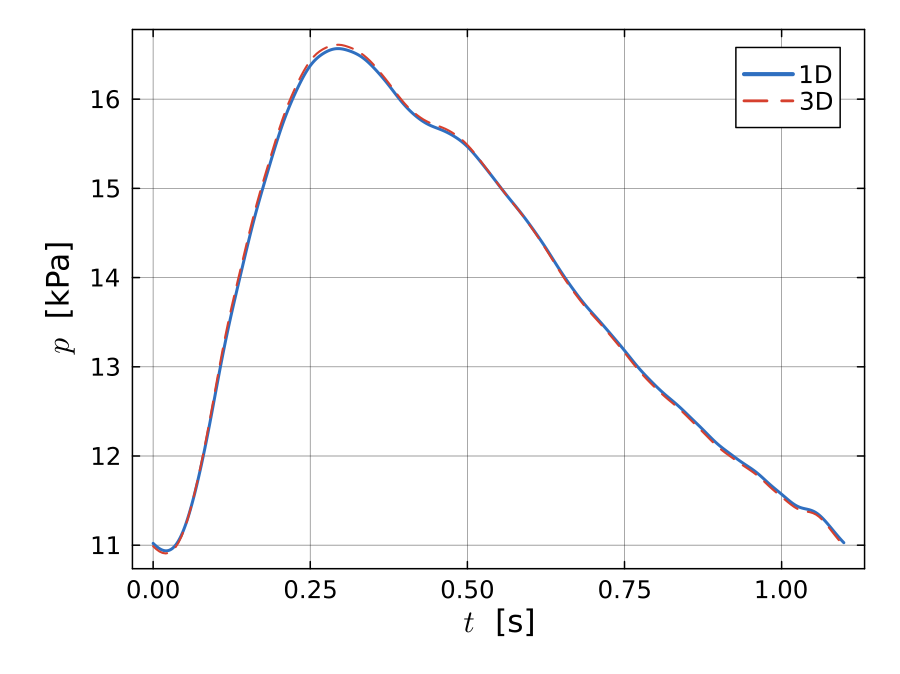
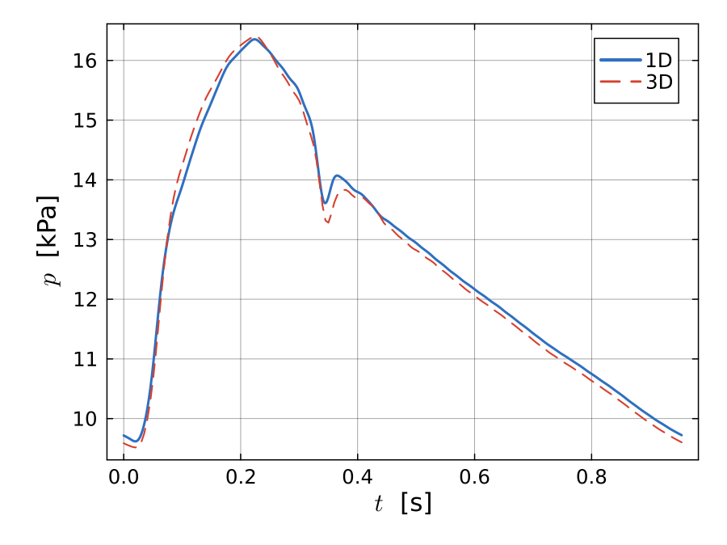
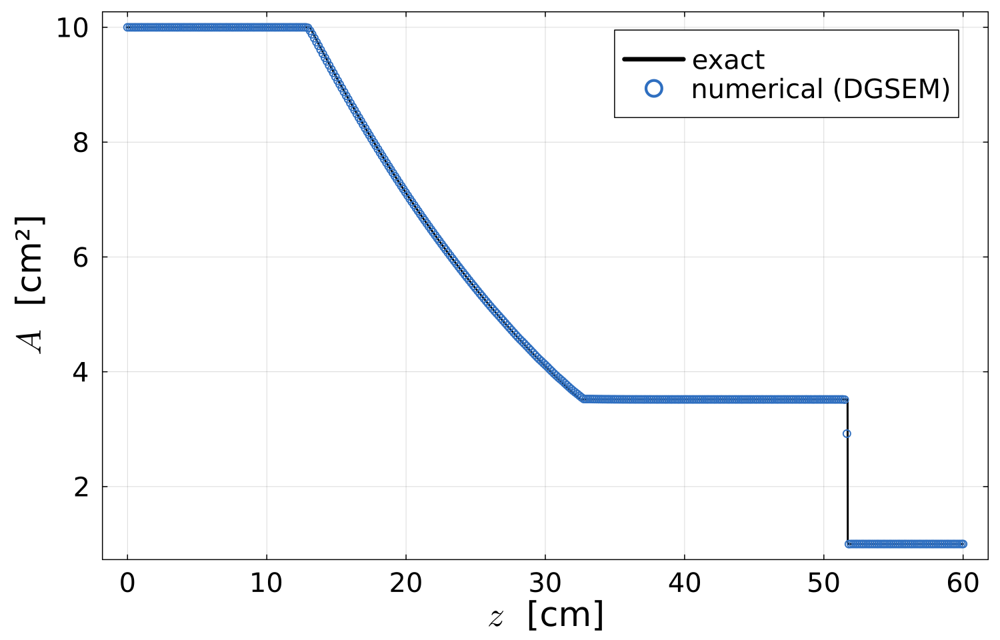
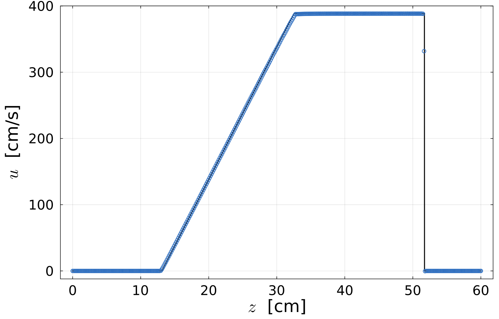
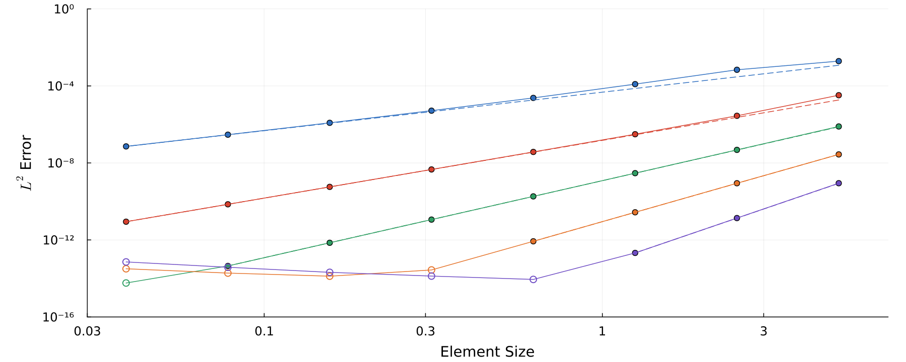
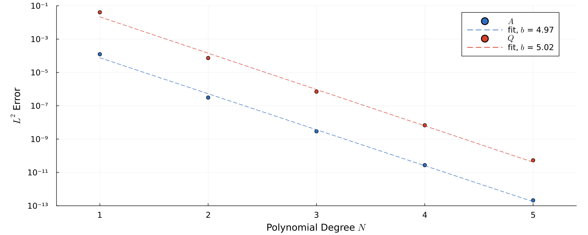

# An energy-stable solver for arterial blood flow

**Michael J. Millard · M.S. thesis · New Mexico Tech · 2026**  
[Julia](https://julialang.org/) · [Trixi.jl](https://github.com/trixi-framework/Trixi.jl) · [Solver source](src/) · [Run a benchmark](#run-the-carotid-benchmark)

I developed and implemented a high-order, energy-stable numerical method for simulating blood flow in elastic arteries. In carotid and aortic benchmarks, the 1D solver closely reproduced the midpoint pressure waveforms from published 3D simulations.

<p align="center">
  
  
  <br>
  <em>Midpoint pressure over the final cardiac cycle. The relative root-mean-square (RMS) difference from the 3D reference was <strong>0.24%</strong> in the carotid (left) and <strong>1.20%</strong> in the upper thoracic aorta (right). <a href="data/README.md">Benchmark data and references</a>.</em>
</p>

## Research contributions

- **Energy stability.** The thesis derives an energy-conservative numerical flux for the blood flow equations in cross-sectional area and flow rate. The construction applies to a broad class of elastic vessel wall models. Adding dissipation at element interfaces yields an energy-stable flux.
- **Solver design.** The Julia implementation couples a discontinuous Galerkin spectral element method (DGSEM) to a three-element Windkessel model of downstream circulation. Both use the same flow rate at the outlet, so the coupling conserves mass. The carotid and aorta benchmarks used one and two degree-four elements, respectively.
- **Verification.** A convergence test with a smooth manufactured solution recovered the expected second- through sixth-order accuracy under mesh refinement. The solver also reproduced the exact wave patterns in four Riemann problems.
- **Validation.** In the single-pulse benchmark, the inviscid wave speed was **0.059% above** the prediction from linear theory. In both artery benchmarks, RMS discrepancies from the 3D reference for midpoint pressure, flow rate, and radius change fell within the ranges of six published 1D solvers.

<details>
<summary>Energy estimate and related work</summary>

Bürger et al. derived a related flux for the area–velocity formulation. For the square-root vessel model used in the benchmarks, the area–flow rate flux derived here recovers the polytropic Euler flux of Winters et al. For the flat velocity profile assumed here and positive nodal areas, the DGSEM without shock capturing satisfies a semidiscrete mechanical-energy estimate that accounts for wall friction, interface dissipation, and energy transfer at the vessel ends.

</details>

### Riemann problem with a rarefaction and a shock

In Test 2, the solver follows the smooth rarefaction through the sonic point and captures the right-moving shock near its exact position.

<p align="center">
  
  
  <br>
  <em>Cross-sectional area <i>A</i> (left) and velocity <i>u</i> (right) in Riemann Test 2, compared with the exact solution.</em>
</p>

<details>
<summary>Convergence under mesh and polynomial refinement</summary>

<p align="center">
  
  <br>
  <em>On the smooth test problem, polynomial degrees 1 through 5 gave approximately second- through sixth-order convergence in area.</em>
</p>

<p align="center">
  
  <br>
  <em>At fixed element size, the area and flow-rate errors decrease approximately exponentially with polynomial degree (spectral convergence).</em>
</p>

</details>

## Run the carotid benchmark

With [Julia](https://julialang.org/downloads/) installed, run these commands from the repository root.

```bash
julia --project=. -e 'using Pkg; Pkg.instantiate()'
julia --project=. experiments/carotid/carotid.jl
```

Run the main experiment suite with `julia --project=. run_all.jl`. It writes figures and tables to `results/`. Run the test suite with `julia --project=. test/runtests.jl`.

[Experiments](experiments/) · [Tests](test/) · [Benchmark data](data/)

<details>
<summary>Experiment commands and reproducibility notes</summary>

The reported results were generated with Julia 1.12.6. [`Project.toml`](Project.toml) declares the dependencies, including Trixi.jl for spatial discretization and OrdinaryDiffEqLowStorageRK.jl for time integration. [`Manifest.toml`](Manifest.toml) records the exact versions of the direct and transitive dependencies.

Run each script with `julia --project=.` followed by the path and any arguments in the table.

| Thesis section | Script | Approx. runtime |
| --- | --- | --- |
| §4.1 Convergence | `experiments/convergence/convergence.jl` | 10 min |
| §4.2 Riemann problems and threshold sweep | `experiments/riemann/riemann.jl --T-sweep` | 11 min |
| §5.1 Single-pulse propagation | `experiments/single_pulse/single_pulse.jl` | 1 min |
| §5.2 Carotid artery | `experiments/carotid/carotid.jl` | 1 min |
| §5.3 Upper thoracic aorta | `experiments/aorta/aorta.jl` | 1 min |
| Appendix, discretization refinement | `experiments/refinement/refinement.jl` | 15 min |

- [`run_all.jl`](run_all.jl) runs the first five rows in separate single-threaded processes in about 25 minutes. Run the appendix refinement study separately to reproduce the numerical deviations in the refinement table. Wall-clock times depend on the machine.
- The threshold sweep tests how sensitive shock detection is to the choice of threshold. Omit `--T-sweep` to run the Riemann cases with the selected threshold of 10<sup>−5.5</sup> in about two minutes.
- The test suite covers the flux properties, shock indicator, exact Riemann solver, benchmark error tables, and the temporal order and volume conservation of the Windkessel coupling.
- On an AMD Ryzen 7 7735U in that environment, SHA-256 checks confirmed that the outputs matched the original thesis code byte for byte. Other processors or Julia versions can produce round-off differences. PNG output also depends on the GR binary.

</details>

## Citation and license

To cite this work, see [`CITATION.cff`](CITATION.cff) for *An Energy-Stable Discontinuous Galerkin Spectral Element Method for One-Dimensional Blood Flow*. The code is [MIT-licensed](LICENSE). Parts of `src/shock_indicator.jl` and `experiments/riemann/riemann.jl` are adapted from Trixi.jl (MIT). The [benchmark data](data/README.md) are from Boileau et al. (2015) and are released under CC0 1.0.
